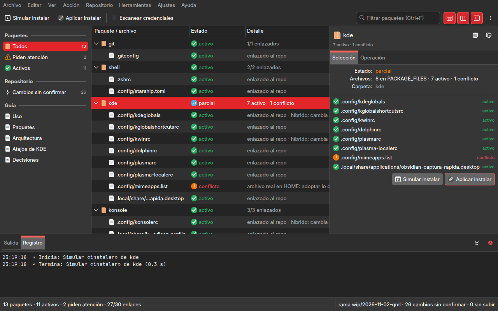
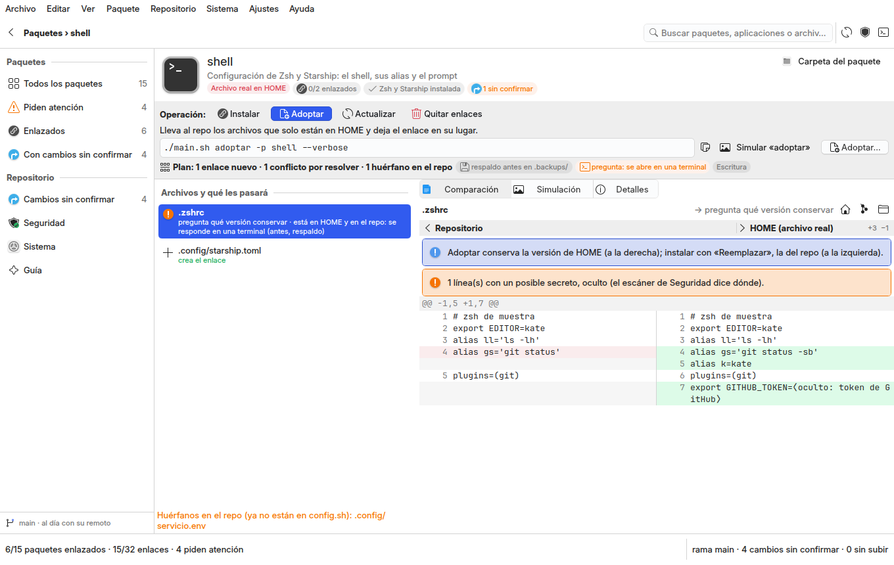
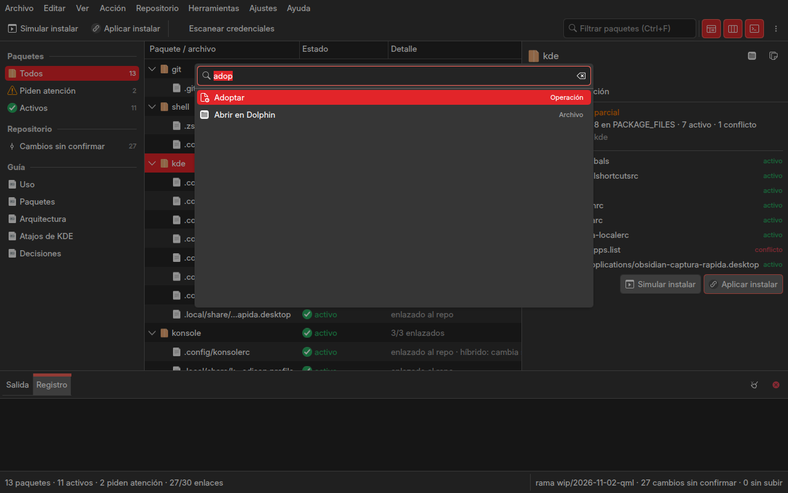

# Rediseño de Dotfiles Studio: los paquetes del repo y lo que `main.sh` hace con ellos

Fase 5 de la modernización de la familia de studios (`gui-comun/docs/arquitectura-qml-kirigami.md` §8): Dotfiles
Studio es el segundo que sigue al piloto Git Studio, cuyo lenguaje visual y arquitectura de información
(`git-studio/docs/rediseno.md` §2, §4, §6, §8) el autor aprobó el 2026-11-01 «para todos los programas de la
familia», y el primero (Filesystem Studio, `filesystem-studio/docs/rediseno.md`) mostró cómo se aplica a un studio de
herramientas: una ventana, Ejecutar (F5) simula o lee, Aplicar (Ctrl+Intro) escribe tras confirmar. Este documento
aplica ese diseño a este studio: la auditoría de lo que hay (§1), las ocho preguntas de producto (§2), la
arquitectura de información (§3), la ventana (§4), lo construido (§5), los componentes (§6), lo que el marco
necesitó (§7) y las decisiones (§8). **Está construido** (rama `wip/2026-11-02-qml`, 2026-11-02): las capturas de §5 son
reales; pasa a `hecho` cuando el autor valide el studio en la sesión real (P3, `../estado.md`).



## 1. Auditoría de la GUI actual (Widgets, `gui-comun` 1.x)

Seis páginas en una barra lateral con la marca «Dotfiles Studio» (el módulo `ventana.py` de 1.x, 405 líneas, retirado en esta fase), todas
construidas a mano con `gui_comun.widgets` (tarjetas, cifras, listas con vacío, consola como cajón, paleta Ctrl+K,
avisos flotantes). La lógica (`studio/dotfiles_app/estado.py`, 250 líneas, sin Qt) ya está separada: lee el mapa de
paquetes de `config.sh` por Bash, calcula el estado de cada archivo con la leyenda de `main.sh estado`, lee git y
construye la orden de confirmar por ruta.

| página | qué hace hoy | entidades y operaciones | lógica separada (`estado.py`) | mezclado en la ventana |
|---|---|---|---|---|
| Inicio | cuatro cifras (paquetes, enlaces, cambios, commits sin subir) y la lista «Lo que pide atención» (archivos no activos y cambios sin confirmar; doble clic lleva a la página) | paquete, archivo, cambio | `paquetes()`, `estado_git()` | el recuento y el texto de cada cifra; es un panel de control |
| Paquetes | una tarjeta por paquete (nombre, estado, archivos que no están activos con su explicación, nota para calibre y KOReader) con cuatro botones: Simular (`instalar --dry-run --verbose`), Instalar, Adoptar, Eliminar (`--force`; cada uno con `QMessageBox` antes y respaldo en `.backups/`) | paquete: nombre, estado (activo · parcial · conflicto · pendiente · ausente · sin config), archivos; operación de `main.sh` por paquete | `mapa()`, `estado_de()`, `Paquete.estado` | la orden de `main.sh` (`_main_sh`), la confirmación y el texto de cada operación; las tarjetas no son un modelo: se pintan a mano y no se ordenan ni se filtran |
| Cambios | lista de archivos con cambios (nuevo · modificado · híbrido) y el diff entero del elegido en un `QPlainTextEdit`; «Confirmar este archivo…» pide el mensaje con `QInputDialog` y corre escáner + `git add -- ruta` + `git commit -- ruta`; «Subir» (`git push`) tras confirmar | cambio: ruta, código de `git status --porcelain`, híbrido; rama, commits adelante y atrás | `estado_git()`, `diff()`, `orden_confirmar()` | la orden de `git push`; el diff sin resaltado; la lista se rellena a mano |
| Seguridad | una tarjeta con «Escanear» (`main.sh seguridad`) | el escáner de credenciales | — | todo (es un botón) |
| Sistema | tres tarjetas (Fuentes de usuario, Dependencias, Respaldo) con Simular (`--dry-run`) y Aplicar (`QMessageBox` antes) | `instalar-fuentes`, `instalar-deps`, `backup` | — | las órdenes y la confirmación; `instalar-deps` pide `sudo` y no tiene terminal |
| Guía | un `QComboBox` con cinco documentos (`README.md`, `docs/*.md`) y un `QTextBrowser` que los muestra sin el frontmatter | documento | — | la lista de documentos y la lectura del archivo |

Preferencias: solo `ui/tema` (`QSettings`), que en 2.x no hace nada (el tema es del escritorio). La paleta ofrece
«Paquete <nombre>» para cada paquete, pero solo lleva a la página Paquetes. El `.desktop` de hoy invoca el Python de
Anaconda, cuyo Qt no carga Kirigami.

Lo que está bien y se conserva: `estado.py` entero (el mapa por Bash sin copiarlo, la leyenda de `main.sh estado`, el
diff entero antes de confirmar, confirmar por ruta tras el escáner, nunca `sync-push`), la regla de que la ventana no
escribe por su cuenta (toda orden es `main.sh` o `git`), `--force` solo en eliminar (la ventana ya preguntó y `main.sh`
leería la terminal), el respaldo antes de instalar y adoptar, las pruebas sobre un repo y un `HOME` falsos. Lo que no
cumple el diseño aprobado: la marca dentro de la ventana, la portada con cifras, las páginas que son formularios con
botones, Seguridad y Sistema como páginas para tres botones, la consola como cajón, la lista de paquetes sin modelo,
el diff sin resaltado, el lanzador con el Python equivocado.

Dos límites del gestor que la ventana hereda y que esta fase hace visibles: `main.sh` pregunta por `/dev/tty` cuando
adopta un archivo que existe en los dos lados (`_resolve_conflict`) o instala sobre un archivo real sin `--force`
(`_install_package`), y sin terminal toma la opción segura (saltar); `confirm_action` de eliminar y de `sync-push` lee la
entrada estándar, que en un proceso hijo de la ventana no responde. Por eso la ventana debe decir qué quedó saltado y,
cuando la operación necesita responder (adoptar con conflictos, dependencias con `sudo`), abrirla en una terminal.

## 2. Las ocho preguntas de producto

1. **Tarea principal**: saber de un vistazo qué paquetes de la máquina están enlazados al repo y cuáles piden algo
   (un archivo real donde iría un enlace, un archivo del repo sin enlazar, uno que no existe), arreglarlos con
   `main.sh` sin escribir la orden, y confirmar al repo público los cambios que las aplicaciones dejaron, de uno en
   uno y con el diff entero a la vista. El paquete es el sujeto; instalar, adoptar y eliminar, los verbos; el repo,
   el segundo sujeto.
2. **Información constante**: cuántos paquetes y enlaces están activos y cuántos piden atención; la rama, cuántos
   cambios sin confirmar y cuántos commits sin subir; qué operación se va a simular o aplicar. → la **barra de
   estado** (paquetes y enlaces a la izquierda; rama, cambios y commits a la derecha), los **contadores del panel
   de navegación**, la **operación elegida en el panel de detalles**.
3. **Acciones más frecuentes**: simular la operación sobre el paquete seleccionado, aplicarla, confirmar el archivo
   seleccionado, escanear credenciales, releer el estado. → **la barra: Ejecutar (F5) · Aplicar (Ctrl+Intro) ·
   Escanear credenciales**, y el filtro.
4. **Lo que permanece visible**: el árbol de paquetes (o la tabla de cambios) y la barra de estado. Navegación,
   detalles y salida se pliegan.
5. **Operaciones contextuales**: sobre un paquete (simular, instalar, adoptar, eliminar, abrir su carpeta en
   Dolphin, copiar la ruta); sobre un archivo del mapa (lo mismo que su paquete, más la ruta en `HOME` y en el repo);
   sobre un cambio (ver el diff, confirmar, copiar la ruta, abrir en Dolphin). → **menú contextual y panel de
   detalles.**
6. **Solo cuando se pide**: la explicación de cada estado, los archivos de un paquete y el destino de cada enlace,
   el diff de un cambio, la rama y los commits adelante y atrás, la salida íntegra de `main.sh`, los documentos del
   repo. → **panel de detalles (Selección · Operación · Diferencia · Repositorio · Documento), panel inferior, vista
   Guía.**
7. **Una sesión completa**: abrir → el estado ya está (se lee en el arranque) → «Piden atención» en la navegación →
   seleccionar `kate` → en Operación está marcado «Instalar» → F5 simula en el panel inferior → Ctrl+Intro pregunta
   («Instalar kate: crea los enlaces de 3 archivos; antes, respaldo en .backups/») → corre → el árbol se relee y el
   paquete queda activo → Ctrl+2, Cambios → seleccionar `kate/.config/katerc` → la Diferencia muestra el diff entero
   → escribir el mensaje y Ctrl+Intro → el escáner corre y el commit entra → la barra de estado dice «1 commit sin
   subir» → Repositorio › Subir a GitHub… → F4 cierra la salida.
8. **Tamaños**: como el piloto (§4.2 de su rediseño): bajo 900 px la navegación se pliega a iconos y los detalles se
   abren como hoja; la columna «Detalle» del árbol se oculta al estrecharse.

## 3. Arquitectura de información

### 3.1 Tres vistas, una ventana

Las seis páginas desaparecen como páginas. Hay **tres vistas** del centro, que se eligen en el panel de navegación
(Ctrl+1 · Ctrl+2 · Ctrl+3), y **operaciones** que viven en el menú y se simulan o aplican sobre lo seleccionado:

| vista | centro | detalles (pestañas) | panel inferior | qué ejecuta F5 · qué aplica Ctrl+Intro |
|---|---|---|---|---|
| Paquetes (filtros Todos · Piden atención · Activos) | `ArbolDatos`: paquete › archivo (Paquete / archivo, Estado con color semántico y emblema, Detalle) | Selección: el paquete (estado, archivos por estado, nota de calibre y KOReader) o el archivo (ruta en `HOME`, ruta en el repo, estado y su explicación, destino del enlace, híbrido) · Operación: Instalar · Adoptar · Eliminar (una marcada), «Detallado», «Reemplazar los archivos reales», la orden exacta que correrá | la salida íntegra de `main.sh` | F5 **simula** la operación marcada sobre los paquetes seleccionados (`--dry-run --verbose`) · Ctrl+Intro **aplica** tras un diálogo con los paquetes, lo que hace y el aviso del respaldo |
| Cambios | `TablaDatos` (Archivo, Paquete, Estado, Nota) ordenable y filtrable | Diferencia: el diff entero con resaltado `Diff`, el mensaje del commit al pie y «Confirmar» · Repositorio: rama, commits adelante y atrás, cambios, híbridos; «Subir a GitHub…» | la salida del escáner, de `git commit` y de `git push` | F5 relee el estado de git · Ctrl+Intro **confirma el archivo seleccionado** (escáner → `git add -- ruta` → `git commit -- ruta`) |
| Guía (Uso · Paquetes · Arquitectura · Atajos de KDE · Decisiones) | el documento en Markdown, sin el frontmatter | Documento: título, tipo, estado y ruta; «Abrir con el sistema» | — | F5 relee el documento |

**Inicio** se reparte: las cuatro cifras van a la **barra de estado** (paquetes y enlaces · rama, cambios y
commits) y a los **contadores de la navegación**; «Lo que pide atención» es el filtro **Piden atención** de Paquetes
y la vista **Cambios**. **Seguridad** es la acción «Escanear credenciales» (barra y menú Repositorio). **Sistema**
son tres acciones del menú Herramientas (Instalar fuentes de usuario…, Instalar dependencias…, Respaldo de la
configuración…), cada una un diálogo con «Simular» y «Aplicar». La paleta sigue ofreciendo cada paquete («Paquete:
kate» lo selecciona en el árbol) y cada documento («Guía: Arquitectura»).

### 3.2 Entidades y dónde vive cada dato

| entidad | datos | dónde |
|---|---|---|
| Paquete (`STOW_PACKAGES`, `PACKAGE_FILES` de `config.sh`, leídos por Bash) | nombre, archivos, estado (activo · parcial · conflicto · pendiente · ausente · sin config), cuántos por estado, si sustituye el enlace al guardar (calibre, KOReader) | fila padre del árbol (Estado con color: positivo, neutro, negativo, inactivo); Selección; contadores de la navegación; barra de estado |
| Archivo del mapa | ruta relativa a `HOME`, estado con la leyenda de `main.sh estado`, explicación, híbrido, ruta en el repo, destino real del enlace | fila hija del árbol (emblema por estado); Selección |
| Operación de paquete (`main.sh instalar · adoptar · eliminar -p …`) | verbo, paquetes, `--dry-run`, `--verbose`, `--force`; qué hace y qué respalda | Operación (detalles) y menú Acción; la orden en el panel inferior; progreso en la barra de estado |
| Cambio (`git status --porcelain`) | ruta, código, nuevo o modificado, híbrido, paquete | tabla de Cambios (color solo en Estado); Diferencia |
| Repositorio | rama, commits adelante y atrás, cambios, ruta | barra de estado (contexto), Repositorio (detalles), título de la ventana (`.dotfiles — Dotfiles Studio`, como Dolphin pone la carpeta) |
| Operación del repo (escáner, confirmar por ruta, subir) y del sistema (fuentes, dependencias, respaldo) | orden, salida, resultado | panel inferior (Salida, Registro); barra de estado mientras corre; `Mensajes` solo si falla |
| Documento (`README.md`, `docs/*.md`) | título y tipo del frontmatter, estado, cuerpo | Guía (centro) y Documento (detalles) |
| Preferencias (`QSettings`) | «Detallado» por omisión, terminal para lo que pide `sudo` | «Configurar Dotfiles Studio…» |

### 3.3 Dónde vive cada operación

Toda operación existe una sola vez, en `Acciones` (`studio/dotfiles_app/aplicacion.py`), y aparece en los lugares de
la tabla.

| operación | menú | barra | contextual | detalles | paleta | atajo |
|---|---|---|---|---|---|---|
| Abrir en Dolphin · Abrir terminal aquí · Copiar ruta (el paquete, el archivo o el cambio seleccionado; si no, el repo) | Archivo | | ● | ● (Selección) | ● | Mayús+F4 · Ctrl+Mayús+C |
| Filtrar · Seleccionar todo · Expandir todo · Contraer todo | Editar | ● (campo) | ● | | ● | Ctrl+F · Ctrl+A · Ctrl+Mayús++ · Ctrl+Mayús+− |
| Ir a cada vista (Paquetes · Cambios · Guía) · filtros de paquetes | Ver › Vista | | | | ● | Ctrl+1 · Ctrl+2 · Ctrl+3 |
| Paneles · pantalla completa | Ver | ● | | | ● | F9 · F11 · F4 · Ctrl+Mayús+F |
| Ejecutar (simular la operación · releer el estado · releer el documento) | Acción | ● | ● | ● (botón) | ● | F5 |
| Aplicar (aplicar la operación · confirmar el archivo) | Acción | ● (habilitada cuando hay selección) | ● | ● (botón) | ● | Ctrl+Intro |
| Cancelar la operación | Acción | (barra de estado) | | | ● | Esc |
| Instalar · Adoptar · Eliminar (la operación marcada) · Detallado · Reemplazar los archivos reales | Acción | | ● | ● (Operación) | ● | |
| Releer el estado · Escanear credenciales · Subir a GitHub… | Repositorio | ● (escáner) | | ● (Repositorio) | ● | |
| Instalar fuentes de usuario… · Instalar dependencias… · Respaldo de la configuración… | Herramientas | | | | ● | |
| Paleta de órdenes | Herramientas | | | | — | Ctrl+Alt+I · Ctrl+K |
| Configurar Dotfiles Studio… | Ajustes | | | | ● | Ctrl+Mayús+, |
| Manual (la Guía) · Acerca de | Ayuda | | | | ● | F1 |

Regla del workspace (R3): **toda herramienta que escribe simula primero y muestra el plan antes de aplicar**. Aquí F5
es siempre la simulación (`--dry-run --verbose` al panel inferior; no toca el disco) y Ctrl+Intro aplica tras un
diálogo que dice sobre qué paquetes, qué hace la operación y que antes se respalda en `.backups/`. Confirmar un
archivo exige su diff a la vista y un mensaje; corre el escáner antes y nunca `git add .`. «Subir a GitHub…» recuerda
que el repo es público. Las tres operaciones de Herramientas ofrecen «Simular» y «Aplicar» en el mismo diálogo.
Nada de `sync-push`.

## 4. Distribución de la ventana (1280 × 800)

```text
┌ .dotfiles — Dotfiles Studio ─────────────────────────────────────────────────────────────── (KWin) ┐
│ Archivo  Editar  Ver  Acción  Repositorio  Herramientas  Ajustes  Ayuda                              │ menú
│ ▶ Simular instalar  ✓ Aplicar instalar… │ 🛡 Escanear credenciales          [🔍 Filtrar]  ▯▯▯ ⋯      │ barra
├──────────────┬───────────────────────────────────────────────────────┬──────────────────────────────┤
│ PAQUETES     │ Paquete / archivo           Estado        Detalle     │ 📦 kate                      │
│ ▸ Todos   13 │ ▸ git                       ● activo      1/1 enlazado│ ~/.config/katerc, …          │
│   Atención 3 │ ▾ kate                      ● parcial     2 OK · 1 ⚠  │ Selección  Operación         │
│   Activos 10 │     .config/katerc          ⚠ conflicto   archivo real│ Operación: (•) Instalar      │
│ REPOSITORIO  │     .config/kate/lspclient… ✓ activo                  │            ( ) Adoptar       │
│   Cambios  9 │     .config/kate/externalto… ✓ activo                 │            ( ) Eliminar      │
│ GUÍA         │ ▸ kde                       ● activo      8/8        │ [x] Detallado (--verbose)    │
│   Uso        │ ▸ konsole                   ● activo      3/3        │ [ ] Reemplazar archivos reales│
│   Paquetes   │ ▸ texstudio                 ○ pendiente   sin enlace │ $ ./main.sh instalar -p kate │
│   …          │                                                       │ [▶ Simular] [✓ Aplicar…]     │
├──────────────┴───────────────────────────────────────────────────────┴──────────────────────────────┤
│ Salida │ Registro                                                                        ⌫  ✕        │ F4
│ $ bash main.sh instalar -p kate --dry-run --verbose                                                  │
│ [INFO] … [dry-run] ln -sfn …/kate/.config/katerc → ~/.config/katerc                                   │
├─────────────────────────────────────────────────────────────────────────────────────────────────────┤
│ 13 paquetes · 10 activos · 3 piden atención · 37/41 enlaces        main · 9 cambios sin confirmar · 0 sin subir │
└─────────────────────────────────────────────────────────────────────────────────────────────────────┘
```

Proporciones y comportamiento según el ancho: los del piloto (`git-studio/docs/rediseno.md` §4.1–4.2); paneles,
divisores, geometría y anchos de columna de la tabla se recuerdan en QSettings.

## 5. Lo construido

Tres capturas reales (`studio/capturar.py`, 1280 × 800, el Qt del sistema con Kirigami 6.24, el repo real sin tocar
el escritorio ni las preferencias): la vista Paquetes con `kde` seleccionado tras simular su instalación, en Lliphi
Oscuro (Selección) y Lliphi Claro (Operación), y la paleta de órdenes filtrando «adop». El panel inferior muestra el
Registro y no la Salida (D8: la salida de `main.sh` lleva rutas de `HOME`).

| | |
|---|---|
|  |  |



Qué hay detrás: `studio/dotfiles_app/aplicacion.py` (el registro de acciones: §3.3 íntegro; Ejecutar y Aplicar cambian
de texto, icono y disponibilidad con la vista y con la operación marcada), cinco controladores (`espacio`,
`paquetes`, `cambios`, `guia`, `sistema`) más `ajustes`, dos módulos de modelos puros (los nodos del árbol y las
filas de la tabla, sin Qt), `estado.py` intacto más seis consultas, `studio/dotfiles_app/qml/Main.qml` sobre
`VentanaStudio` y diez componentes propios (selección y operación del paquete, la diferencia con el commit al pie,
el resumen del repositorio, el documento, la vista de texto con resaltado, los diálogos de sistema y de ajustes);
38 pruebas (`studio/tests/run.sh`: el servicio, los modelos y los controladores sobre un repo y un `HOME` falsos con
una simulación y una instalación y eliminación reales de `main.sh`, una confirmación real por ruta, el escáner con y
sin credencial, cada QML y `--smoke` con `/usr/bin/python3`; una `xfail` estricta documenta que `--dry-run` deja
carpetas vacías en `HOME`). Lo que quedó fuera está en `../estado.md` §Por hacer.

## 6. Componentes

| región | componente | función |
|---|---|---|
| Barra de menú · barra de herramientas · barra de estado · paleta · «Acerca de» | `GuiComun.VentanaStudio` | las de la familia; en `herramientasExtra`, el filtro (Ctrl+F) |
| Navegación | `GuiComun.PanelNavegacion` | secciones Paquetes (tres filtros con contador), Repositorio (Cambios con contador) y Guía (los cinco documentos) |
| Centro | `GuiComun.ArbolDatos` (Paquetes), `GuiComun.TablaDatos` (Cambios), vista de texto en Markdown (Guía) | el resultado de la vista; color semántico solo en Estado; emblemas del tema (`vcs-*`, `dialog-*`); menú contextual con las mismas acciones |
| Detalles | `GuiComun.PanelDetalles` con pestañas por vista; formularios en `Kirigami.FormLayout`; el diff con `org.kde.syntaxhighlighting` (`Diff`) | Selección y Operación (Paquetes), Diferencia y Repositorio (Cambios), Documento (Guía); los botones Ejecutar y Aplicar repetidos al pie |
| Panel inferior | `GuiComun.PanelInferior` | la salida íntegra de `main.sh` y de `git` (Salida) y los eventos de la sesión (Registro) |
| Diálogos | `Kirigami.PromptDialog` (aplicar la operación, subir a GitHub, las tres de Herramientas con Simular y Aplicar), `GuiComun.DialogoAjustes` (General) | lo que se pide y se cierra |

## 7. Lo que el marco necesitó

Nada nuevo en `gui-comun` para este studio: `ArbolDatos`, `TablaDatos`, `PanelDetalles`, `PanelInferior`,
`PanelNavegacion`, `CampoRuta`, `DialogoAjustes`, `ModeloArbol`, `ModeloTabla` y `ModeloFiltrado` de 2.1 bastan. La
vista de texto de solo lectura con resaltado (el diff aquí, el árbol de `tree` en Filesystem Studio, la diferencia de
Git Studio) se repite por tercera vez como componente propio: es candidata a `GuiComun.VistaTexto` en 2.2 (anotado en
`gui-comun/estado.md` §Por hacer).

## 8. Decisiones

| id | decisión | por qué |
|---|---|---|
| D1 | Tres vistas (Paquetes, Cambios, Guía) y operaciones en el menú en lugar de seis páginas; Inicio, Seguridad y Sistema desaparecen como páginas | el diseño aprobado de la familia: ningún panel de control; una operación no es un lugar |
| D2 | La operación de paquete (Instalar · Adoptar · Eliminar) se marca una vez y F5 la simula, Ctrl+Intro la aplica tras confirmar | regla 3 del workspace y la gramática de Filesystem Studio; hoy cada tarjeta tenía cuatro botones y «Simular» solo simulaba instalar |
| D3 | `--force` va con eliminar siempre (también al simular) y con instalar solo si se marca «Reemplazar los archivos reales»; adoptar con conflictos y `instalar-deps` se abren en una terminal | `confirm_action` lee la entrada estándar y `_resolve_conflict` pregunta por `/dev/tty`: sin terminal, eliminar se quedaría esperando y adoptar saltaría el conflicto en silencio; `sudo` necesita una terminal |
| D4 | Confirmar sigue siendo por ruta, con el diff entero a la vista, tras el escáner; el mensaje se escribe junto al diff (patrón de Kate y de Git Studio); no hay `sync-push` | regla del repo (`CLAUDE.md`): nunca `git add .` desde la ventana |
| D5 | El studio corre con `/usr/bin/python3` y `gui-comun` entra como paquete de pip (versión fija, desde el repo público) o por la variable explícita `GUI_COMUN_DIR`; nunca se busca en otra carpeta | el Qt del sistema es el que trae Kirigami; el repo no conoce `~/Documents` (decisión 2026-09-15) |
| D6 | La preferencia `ui/tema` deja de ofrecerse; quedan «Detallado por omisión» y la terminal para lo que pide `sudo` | el tema es del escritorio en 2.x |
| D7 | La vista de texto con resaltado es un componente del studio, no del marco, hasta que `gui-comun` 2.2 la recoja | no bloquea; se anota para el siguiente studio |
| D8 | Las capturas de la documentación muestran Paquetes con el panel inferior en Registro, nunca Salida ni Cambios | el repo es público: la salida de `main.sh` y los diffs llevan rutas de `HOME` |
