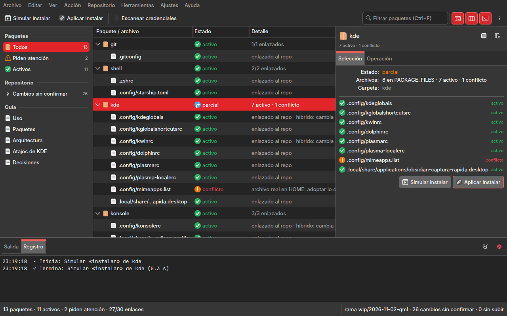
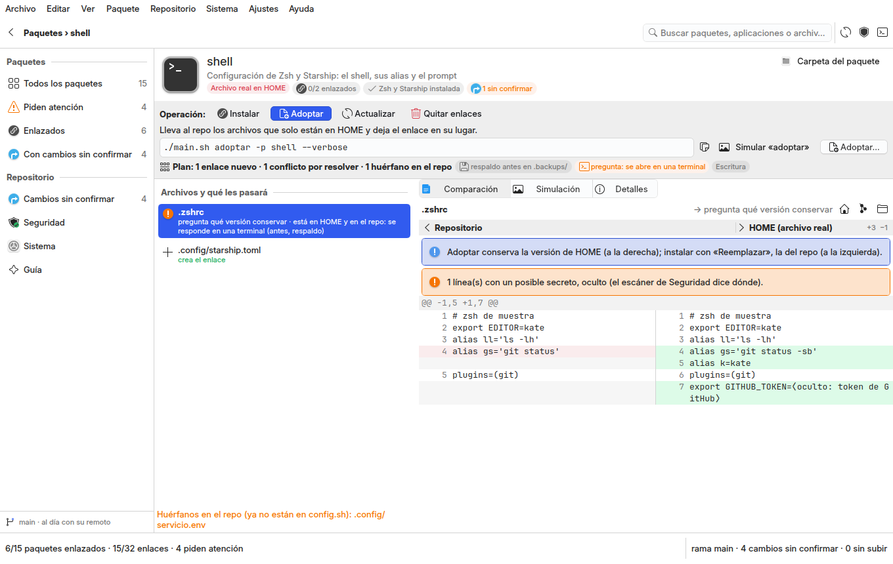
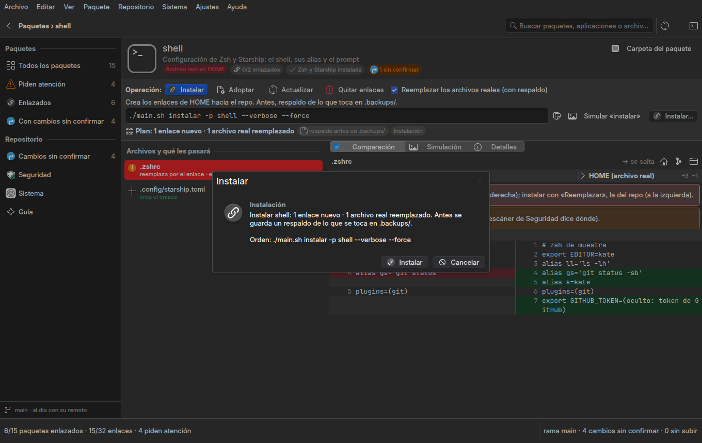
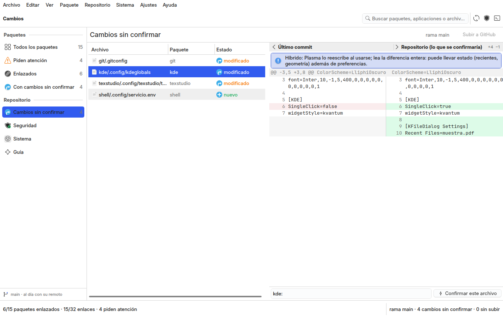
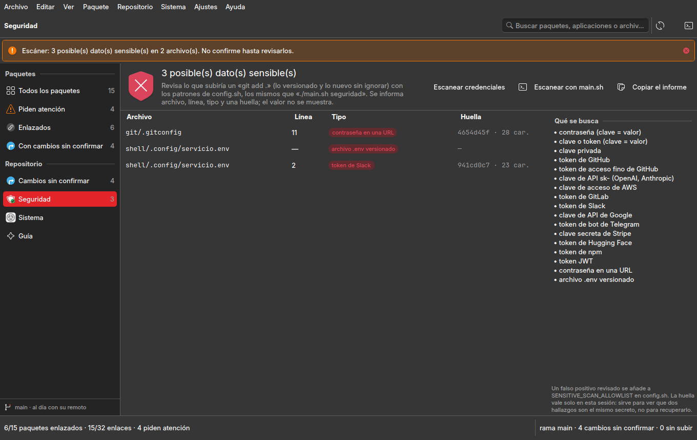
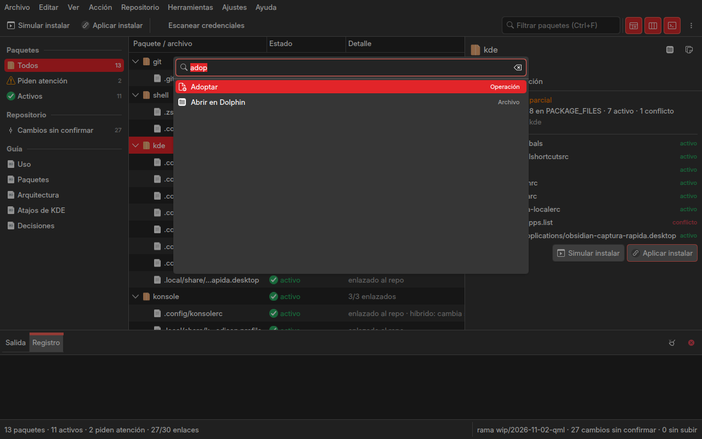

# Reingeniería de Dotfiles Studio

Encargo del autor del 2026-11-02: cada studio deja de ser una variación de Dolphin y toma la arquitectura de su
disciplina. Para Dotfiles Studio, «un administrador de configuración del sistema» con la experiencia de un gestor de
paquetes y de un centro de configuración. Debe mostrar:

- los paquetes de configuración y sus archivos;
- el estado de instalación, las diferencias entre lo local y el repositorio, las dependencias y los conflictos;
- las acciones disponibles.

Antes de adoptar, instalar, actualizar o quitar enlaces hay una vista de comparación. Las órdenes exactas se ven, pero
nadie tiene que ir a la consola. El escáner de credenciales detecta más sin exponer los secretos. La base común es
`gui-comun` 3.0 (`VentanaBase`, `Escritorio`, diálogos de KDE, errores presentables, estados de operación). El diseño
anterior, aprobado el 2026-11-01, está en `rediseno.md`; este documento lo sustituye como guía de la ventana.

## 1. Diagnóstico (leído en el código de `respaldo/antes-reingenieria-2026-11-02`)

### 1.1 Visual y de arquitectura de interacción

- **Es Dolphin con datos de `main.sh`.** `studio/dotfiles_app/qml/Main.qml` es una `VentanaStudio`. Tiene filtros a la
  izquierda, el árbol paquete › archivo en el centro y un panel de detalles a la derecha con dos pestañas (Selección,
  Operación). Abajo están la consola y la barra de estado. Ocultando el nombre, es la misma ventana que Git Studio y
  Filesystem Studio de la fase 5.
- **El paquete no tiene página.** Un paquete es una fila del árbol con tres columnas (nombre, estado, detalle). Su
  aplicación, sus dependencias, sus notas (híbrido, la aplicación sustituye el enlace) y lo que va a pasar con cada
  archivo quedan repartidos entre pestañas de 24 unidades de ancho.
- **La operación se elige en un menú.** Instalar, adoptar o eliminar es una opción marcable de «Acción»: F5 simula
  la marcada y Ctrl+Intro la aplica. Nada en el centro dice qué operación está marcada ni qué hará con cada archivo.

### 1.2 Funcional

- **No hay comparación antes de actuar.** Lo único que se ve antes de aplicar es la orden y un texto general
  (`DESCRIBE`, en el controlador de paquetes de entonces). La diferencia entre el archivo de HOME y el del repo, que es lo que
  decide si adoptar o instalar, solo la imprime `main.sh` en la terminal (`_resolve_conflict`, las primeras líneas del diff) y solo al
  adoptar.
- **El plan por archivo no existe.** `main.sh` decide archivo por archivo, y la ventana no lo anticipa:
  - crea el enlace, rehace el que ya existe o salta el que no está en el repo;
  - con un archivo real en HOME, lo salta (sin `--force`) o lo respalda y reemplaza (con `--force`);
  - mueve al repo lo que solo está en HOME;
  - pregunta por la terminal cuando el archivo está en los dos lados;
  - puede proponer borrar los huérfanos del repo.

  Para saberlo hay que simular y leer la salida.
- **`actualizar` no se ofrece**, y conviene que siga así sin una vista previa: `update_configs` hace `ln -sfn` sobre
  cada archivo del repo, y `ln -f` borra sin respaldo el archivo real que haya en HOME.
- **Un archivo que solo está en HOME cuenta como «ausente».** `estado.estado_de` no distingue «no existe en ningún lado»
  de «existe en HOME y no en el repo», que es justo lo que adoptar lleva al repo.
- **Dependencias y conflictos no se modelan.** No se sabe:
  - si la aplicación de un paquete está instalada (calibre, Positron, RStudio…);
  - si dos paquetes reclaman la misma ruta;
  - qué paquetes del sistema necesita el gestor (`_install_deps_apt`).
- **Los híbridos se nombran pero no se explican.** `HIBRIDOS` marca `kdeglobals`, `kwinrc`, `konsolerc` y
  `texstudio.ini`, y la tabla de cambios los señala. Pero el diff es un texto plano, y el filtro `clean` de
  `texstudio.ini` (`.gitattributes`, `lib/filtros/texstudio_ini.sh`) no aparece en ninguna parte: no se ve que git compara
  la versión filtrada.
- **El escáner de credenciales es corto.** `config.sh` tiene cinco patrones:
  - `clave = valor`;
  - las claves privadas RSA, OPENSSH, EC, DSA y PGP;
  - `ghp_` y `sk-`.

  `validate_no_sensitive_data` corta en el primer patrón de cada archivo e imprime la expresión regular, no el tipo ni
  la línea. No reconoce:
  - los tokens de servicios comunes: AWS, GitLab, Slack, Google, Telegram, Stripe, Hugging Face, npm, JWT, los demás
    prefijos de GitHub y las claves de Anthropic;
  - las contraseñas en URLs;
  - los archivos `.env` versionados.

  La ventana solo lanzaba el escáner y mostraba su salida en la consola.
- **Defecto del gestor** (corregido aparte, en `2398f68`): `_create_symlink`, `_ensure_repo_dir` y `_adopt_package`
  hacían `mkdir -p` antes de mirar `DRY_RUN`. «Instalar» o «adoptar» con `--dry-run` creaban carpetas en HOME o en el
  repo. La prueba `xfail` pasó a ser una prueba, y se sumó otra para adoptar.

### 1.3 Usabilidad

- La confirmación de aplicar es un `PromptDialog` con la orden pegada al final del texto: no dice cuántos archivos se
  reemplazan, cuántos se saltan ni cuáles se respaldan.
- Lo que `main.sh` salta por falta de terminal solo se descubre leyendo la salida.
- Los errores son avisos de una línea («main.sh terminó con código 1: revisa la salida (F4)»). No dicen la causa probable
  ni qué hacer.

### 1.4 Integración con KDE

- `espacio.abrirDolphin` lanza `xdg-open` de la carpeta, sin señalar el archivo. Con `gui-comun` 3.0 hay
  `Escritorio.mostrarEnDolphin` (`dolphin --select`) y `abrirConAplicacion`.
- La aplicación era una `QGuiApplication` (`gui-comun` 2.1): sin el estilo `org.kde.desktop` pintado con `QStyle`.

### 1.5 Capacidades que faltan para su propósito

- Una página por paquete: aplicación, estado, archivos, dependencias, conflictos y acciones.
- La comparación repo ⟷ HOME lado a lado, por archivo, antes de cada operación, con el plan de lo que pasará y la orden
  exacta.
- `actualizar`, con el bloqueo de lo que borraría sin respaldo.
- El estado «solo en HOME».
- Un escáner con nombre, línea y huella de cada hallazgo, que no muestre el secreto en pantalla, en los registros ni
  en los informes. Tampoco en la comparación: una línea con un secreto se enmascara.

### 1.6 Riesgos

- **El repo es público**: ninguna captura ni prueba lleva rutas de la máquina, y las pruebas del escáner arman sus
  secretos falsos al vuelo para que el propio escáner no los encuentre en el código.
- **`main.sh` pregunta por `/dev/tty`** en adoptar con conflictos y en instalar sin `--force`. Sin terminal toma la
  opción segura (saltar). La ventana lo dice en el plan y abre una terminal cuando hay que responder.
- **`actualizar` borra sin respaldo**: la ventana solo la ofrece cuando ningún archivo del paquete es un archivo real
  en HOME.
- **El checkout principal tiene cambios vivos de aplicaciones**: esta reingeniería trabaja en un worktree y las
  pruebas, en un repo y un HOME falsos.

## 2. Referencias

| referencia | qué se toma |
|---|---|
| KDE Discover | la portada de tarjetas (icono, nombre, resumen, estado y la acción principal), la búsqueda arriba, las categorías en la barra lateral, la página de cada elemento (cabecera con icono grande, botón principal, detalles) y la página de actualizaciones con lo pendiente |
| Preferencias del sistema de KDE (Software y actualizaciones) | la lista de orígenes con su estado y la explicación junto a cada opción |
| Meld · Kompare | la comparación lado a lado con números de línea, lo quitado y lo añadido en la misma fila |
| `chezmoi diff` · `stow --simulate` | la comparación antes de aplicar y la simulación que no toca el disco |
| gitleaks · detect-secrets | los tipos de secreto con nombre, el informe por archivo y línea, la huella en lugar del valor |

## 3. Arquitectura nueva

La ventana es un gestor de paquetes de configuración:

- la **portada de paquetes** (tarjetas filtradas por categoría y por búsqueda);
- la **página de cada paquete**: qué es, qué tiene y qué pasará;
- tres páginas del repositorio: **Cambios** (lo que las aplicaciones reescribieron), **Seguridad** (el escáner) y
  **Sistema** (dependencias, fuentes y respaldo);
- la **Guía**.

La barra lateral tiene las categorías y los contadores, como Discover. Cada operación pasa siempre por la comparación
y el plan.

| pieza | qué hace | dónde |
|---|---|---|
| `studio/dotfiles_app/estado.py` | el estado de cada archivo, ahora con `local` (solo en HOME); la aplicación de cada paquete y si está instalada; las rutas que reclaman dos paquetes; los huérfanos del repo | Python sin Qt |
| `studio/dotfiles_app/servicios/plan.py` | lo que `main.sh` hará con cada archivo según la operación (instalar, adoptar, actualizar, quitar enlaces) y si hace falta terminal, respaldo o bloqueo; reproduce `lib/stow_ops.sh` | Python sin Qt |
| `studio/dotfiles_app/servicios/comparar.py` | la comparación de un archivo: repo ⟷ HOME (conflicto), el diff de git con el filtro `clean` (activo e híbrido), lo que se enlazará (pendiente) o lo que entrará al repo (solo en HOME); las líneas con secretos, enmascaradas | Python sin Qt |
| `studio/dotfiles_app/servicios/diferencias.py` | el diff unificado en filas lado a lado (de Git Studio) | Python sin Qt |
| `studio/dotfiles_app/servicios/seguridad.py` | el escáner con los patrones de `config.sh` (los mismos que `main.sh seguridad`): archivo, línea, tipo y huella HMAC de la sesión; nunca el valor | Python sin Qt |
| `studio/dotfiles_app/controladores/catalogo.py` | la portada y la página: tarjetas, filtros, el paquete abierto, el archivo elegido, la operación y su plan, simular y aplicar | Qt |
| `studio/dotfiles_app/controladores/` (`cambios`, `seguridad`, `sistema`, `guia`) | las páginas del repositorio | Qt |
| `studio/dotfiles_app/qml/Main.qml` | `VentanaBase`: barra lateral, cabecera con búsqueda, pila de páginas y barra de estado | QML |

Las operaciones declaran su estado:

- simular es una **simulación**;
- instalar y actualizar son **instalación**;
- adoptar es **escritura**;
- quitar enlaces es **eliminación**;
- subir es **publicación**;
- releer y escanear son **lectura**.

Instalación, eliminación y publicación siempre piden confirmación, con las consecuencias calculadas del plan
(«2 enlaces nuevos, 1 archivo real reemplazado con respaldo»). Los atajos son los de un gestor de paquetes:

- Ctrl+F busca;
- F5 relee;
- Ctrl+Mayús+Intro simula la operación elegida;
- Ctrl+Intro la aplica tras confirmar;
- Alt+Izquierda y Esc vuelven a la portada;
- Ctrl+1…5 llevan a cada página.

## 4. El resultado

Capturas con el repo y el HOME de `studio/muestra.py` (inventados, en un temporal: ninguna ruta ni configuración de
la máquina), hechas con `studio/capturar.py --muestra`.

| antes (fase 5) | ahora |
|---|---|
| un árbol paquete › archivo en el centro y dos pestañas laterales | portada de tarjetas y página por paquete (Discover) |
| la operación, una opción marcable del menú; F5 simula y Ctrl+Intro aplica | la operación se elige en la página, con lo que hace, la orden exacta y su plan |
| antes de aplicar, un texto general | antes de aplicar, la comparación repo ⟷ HOME del archivo elegido y lo que pasará con cada uno |
| `actualizar` no se ofrece | `actualizar`, bloqueada si borraría un archivo real sin respaldo |
| «ausente» mezcla «no existe» y «solo en HOME» | estado «local» (solo en HOME) |
| sin dependencias ni conflictos entre paquetes | la aplicación de cada paquete (instalada o no), las rutas compartidas, los huérfanos del repo, lo que el sistema necesita |
| el diff, texto plano | lado a lado, con el híbrido y el filtro `clean` explicados |
| 5 patrones; imprime la expresión | 16 patrones con nombre y los `.env`; archivo, línea, tipo y huella, nunca el valor; secretos ocultos en las comparaciones |
| éxito = código 0 | éxito y verificación por separado (cada archivo como el plan decía) |
| errores de una línea | errores presentables (qué falló, la orden, qué hacer) |
| `xdg-open` de la carpeta | Dolphin con el archivo señalado (`Escritorio.mostrarEnDolphin`) |

Pruebas: 53 en `studio/tests/run.sh` (repo y HOME falsos). Cubren:

- el plan frente a lo que anuncia `main.sh --dry-run`;
- simular sin escribir;
- instalar con verificación;
- quitar enlaces;
- actualizar bloqueada;
- el escáner de bash y el de la ventana sin el valor;
- la comparación con secretos ocultos;
- cada componente QML y `--smoke`.

## 5. Lo que queda fuera

- `sync-push` y `sync-pull` siguen sin ofrecerse: la ventana confirma por ruta y sube con `git push` tras confirmar.
- Resolver un conflicto archivo por archivo desde la ventana, eligiendo laptop o repo, necesitaría que `main.sh`
  aceptara la elección por argumento. Hoy pregunta por la terminal, y la ventana la abre.
