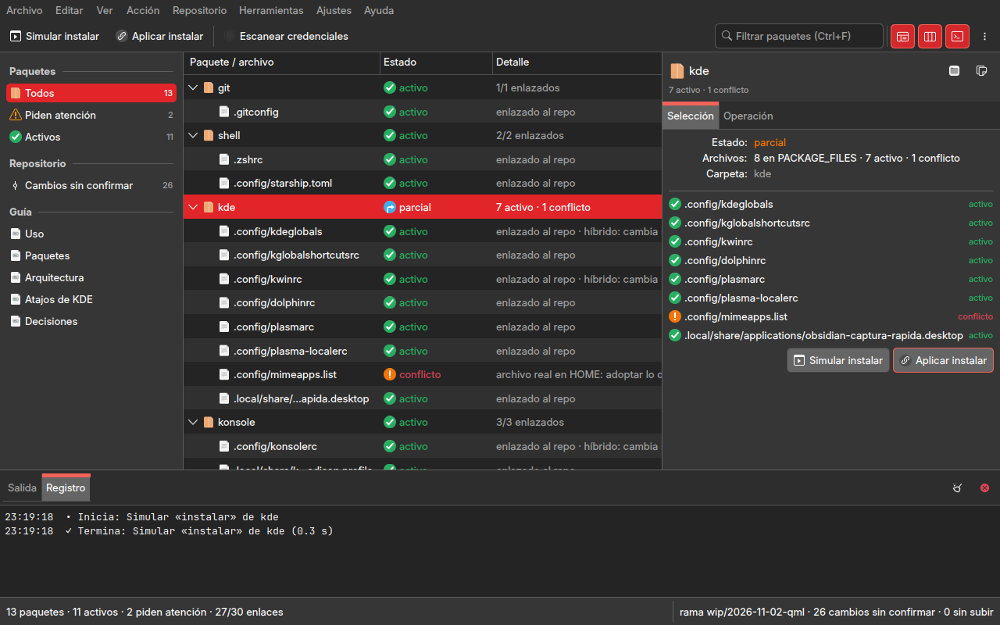
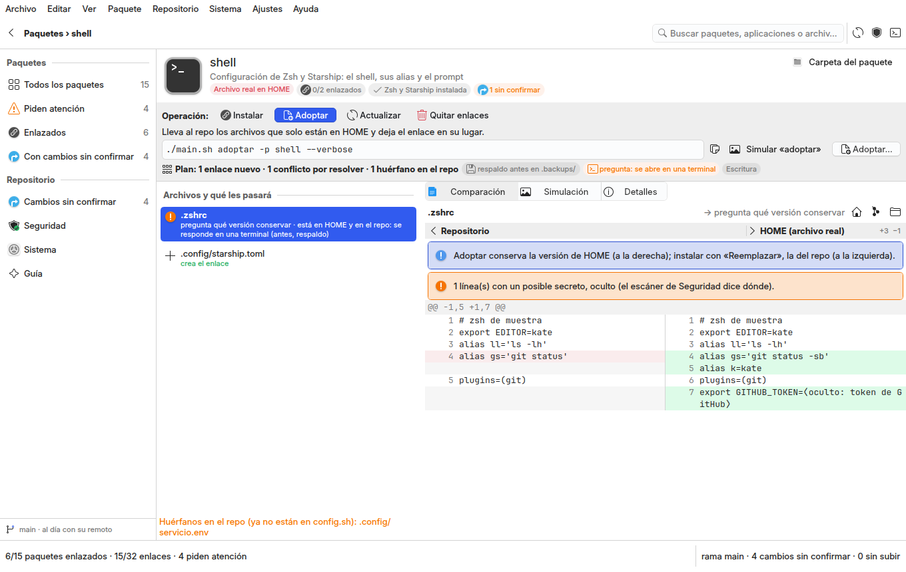

# studio/ — Dotfiles Studio, la ventana opcional del gestor (QML + Kirigami sobre `gui-comun` 3.x)

Un **gestor de paquetes de configuración** con la forma de Discover. Cada paquete del repo es una tarjeta con su
aplicación, su estado y la operación que pide. Su página dice, antes de tocar nada:

- qué hará `main.sh` con cada archivo;
- la orden exacta;
- la comparación repo ⟷ HOME lado a lado.

Además están los **cambios del repo** con su diferencia y la confirmación por ruta, el **escáner de credenciales**
(nunca muestra el secreto), lo que el **sistema** necesita y la **guía**. Es opcional: sin ella, `../main.sh` hace
todo.

Diseño y diagnóstico en `../docs/reingenieria.md` (2026-11-02), que sustituye a `../docs/rediseno.md`. La ventana no
lleva nombre ni logotipo dentro ni colores propios: el esquema, las fuentes y los iconos son los del escritorio.





| región | qué hay |
|---|---|
| menú | Archivo · Editar · Ver · Paquete · Repositorio · Sistema · Ajustes · Ayuda: todas las órdenes con sus atajos |
| cabecera | volver a la portada (Alt+Izquierda o Esc), dónde se está, la búsqueda (Ctrl+F: paquete, aplicación o ruta de un archivo), releer (F5), escanear (Ctrl+Alt+S) y la salida (F4) |
| barra lateral | Paquetes: Todos · Piden atención · Enlazados · Con cambios sin confirmar, con su recuento. Repositorio: Cambios sin confirmar · Seguridad · Sistema · Guía (Ctrl+1 … Ctrl+5). Al pie, la rama y lo que falta subir |
| portada | una tarjeta por paquete con: icono de su aplicación, nombre, qué guarda, estado (Enlazado · Parcial · Archivo real en HOME · Sin enlazar · Solo en HOME · Sin configuración aún), enlaces, híbridos, cambios sin confirmar, aplicación no instalada y el botón de la operación que pide, que abre la página |
| página del paquete | ver la tabla que sigue |
| Cambios | la tabla de `git status`, la diferencia lado a lado (último commit ⟷ repo; híbridos y filtro `clean` explicados, secretos ocultos), el mensaje y «Confirmar este archivo» (Ctrl+Intro); «Subir a GitHub…» |
| Seguridad | qué se busca (los 16 tipos de `config.sh` y los `.env` versionados) y cada hallazgo con archivo, línea, tipo y huella; «Escanear con main.sh» y «Copiar el informe» (sin valores) |
| Sistema | lo que el gestor necesita de la distribución (con su estado) y Dependencias · Fuentes de usuario · Respaldo, cada una con su orden, Simular y Aplicar… |
| Guía | los documentos del repo (Uso, Paquetes, Arquitectura, Atajos de KDE, Decisiones) |
| panel inferior (F4) | Salida (lo que `main.sh` y `git` escriben, íntegro) · Registro |
| barra de estado | paquetes y enlaces · lo que pide atención; tarea en curso con su estado de operación y cancelar; rama · cambios · commits sin subir |
| paleta (Ctrl+K) | cualquier orden, «Paquete: <nombre>» (abre su página) o «Guía: <documento>» |

La página del paquete se compone así:

| parte | qué hay |
|---|---|
| cabecera | icono grande, aplicación, estado y cifras |
| barra de la operación | Instalar · Adoptar · Actualizar · Quitar enlaces; qué hace; la orden exacta (copiable); Simular (Ctrl+Mayús+Intro) y la acción principal (Ctrl+Intro, pide confirmación); el plan resumido y por qué está bloqueada |
| debajo | los archivos con lo que les pasará; del elegido, Comparación · Simulación (la salida de `--dry-run`, sin rutas de la máquina) · Detalles (de qué aplicación depende, rutas compartidas con otro paquete, huérfanos del repo, notas, destino de cada enlace) |

**Regla de todo lo que escribe.** Nada se aplica desde la portada. La operación se elige en la página, con la
comparación y el plan a la vista. Aplicar pide confirmación con las consecuencias calculadas del plan («Instalar
shell: 1 enlace nuevo · 1 archivo real reemplazado. Antes se guarda un respaldo… Orden: …»), con su estado de
operación:

- instalar y actualizar son **instalación**;
- adoptar es **escritura**;
- quitar enlaces es **eliminación**;
- subir es **publicación**.

Al terminar, la ventana relee el disco y **verifica** que cada archivo quedó como el plan decía. `actualizar` se
bloquea si borraría un archivo real sin respaldo. Lo que `main.sh` pregunta por la terminal (adoptar con un archivo
en los dos lados) o pide `sudo` (`instalar-deps`) se abre en una terminal (konsole, configurable en Ajustes).
Confirmar un archivo exige su diferencia a la vista y un mensaje, y corre el escáner antes:
`git add -- ruta` y `git commit -- ruta`, nunca `git add .`. No hay `sync-push`.

## Uso

```bash
/usr/bin/python3 studio/main.py            # desde ~/.dotfiles; --smoke la abre y la cierra
./main.sh instalar-studio                  # el acceso directo en el menú de aplicaciones (-n simula)
/usr/bin/python3 studio/main.py --quitar-lanzador
studio/tests/run.sh                        # pruebas (sin pantalla, repo y HOME falsos)
/usr/bin/python3 studio/capturar.py salida.png --muestra --paquete shell --operacion adoptar --archivo .zshrc
```

Requisitos:

- El Python y el Qt del sistema (Kubuntu 26.04 o equivalente): `python3-pyside6.qtquick`,
  `python3-pyside6.qtquickcontrols2`, `qml6-module-org-kde-kirigami`, `qml6-module-org-kde-kirigamiaddons-formcard`,
  `qml6-module-org-kde-desktop` y `qml6-module-org-kde-syntaxhighlighting`.
- `gui-comun` 3.0 o superior, de una de estas dos formas:
  - **como paquete de pip**, desde su repo público con la versión fija de `dotfiles_app/__init__.py`:
    `/usr/bin/python3 -m pip install --user --break-system-packages "gui-comun @ git+https://github.com/achalmed/gui-comun@v3.0.0"`;
  - señalado con `GUI_COMUN_DIR=<carpeta del repo gui-comun>`, para desarrollar contra una copia local.

El repo no conoce ningún espacio de trabajo: nunca busca `gui-comun` subiendo carpetas. El PySide6 de pip o de
Anaconda no carga Kirigami. Sin lo necesario, `main.py` dice qué instalar y sale con 3.

## Estructura

| carpeta / archivo | qué es |
|---|---|
| `main.py` | entrada, sin lógica; `/usr/bin/python3`; `--smoke`, `--instalar-lanzador`, `--quitar-lanzador` |
| `muestra.py` | un repo y un HOME inventados con cada estado a la vista (y dos secretos falsos para el escáner), para capturas y pruebas a mano |
| `capturar.py` | una captura para la documentación (esquema de color, página, paquete, operación, archivo, simulación, escáner, confirmación, paleta) sin tocar las preferencias ni el escritorio; con `--muestra`, sobre `muestra.py` en un temporal |
| `dotfiles_app/__init__.py` | localiza `gui_comun` (instalado o `GUI_COMUN_DIR`) y dice qué falta (`INSTALAR`) |
| `dotfiles_app/aplicacion.py` | arma la aplicación: controladores, el registro de acciones (menú, barra, paleta, atajos; cada operación con su estado y su confirmación) y carga `dotfiles_app/qml/Main.qml` |
| `dotfiles_app/estado.py` | el servicio, sin Qt: el mapa de `config.sh` por Bash, el estado de cada archivo (la leyenda de `main.sh estado` más «local»), git, el diff entero, confirmar por ruta, las órdenes de `main.sh`, la aplicación de cada paquete, las dependencias del sistema, las rutas compartidas y los huérfanos |
| `dotfiles_app/servicios/` | sin Qt: `plan.py` (qué hará `main.sh` con cada archivo en cada operación, como `lib/stow_ops.sh`), `comparar.py` (la comparación según el estado), `diferencias.py` (el diff en filas lado a lado, de Git Studio), `seguridad.py` (el escáner con los patrones de `config.sh` y la huella HMAC de la sesión) |
| `dotfiles_app/controladores/` | `catalogo` (portada, página, operación, plan, comparación, simular, aplicar y verificar), `cambios`, `seguridad`, `sistema`, `guia`, `espacio` (página activa, barra de estado, Dolphin con `Escritorio`, terminal), `ajustes`: los QObject que QML ve como `studio.<nombre>` |
| `dotfiles_app/modelos/` | funciones puras: las filas de la tabla de Cambios (`cambios.py`) |
| `dotfiles_app/qml/Main.qml` · `componentes/` | la ventana (`GuiComun.VentanaBase`) y sus piezas: `BarraLateral`, `Portada` y `TarjetaPaquete`, `PaginaPaquete`, `VistaDiferencia`, `PaginaCambios`, `PaginaSeguridad`, `PaginaSistema`, `PaginaGuia`, `EtiquetaEstado`, la vista de texto y el diálogo de ajustes |
| `dotfiles_app/recursos/marca.svg` | el icono del lanzador (lo único con el acento del studio) |
| `tests/` | `run.sh`, `conftest.py` (el repo y el `HOME` falsos), el servicio y los servicios nuevos, los controladores, cada QML y `--smoke` |

## Límite honesto

- **La ventana no escribe por su cuenta**: todo es `main.sh` o `git`, y un comportamiento del gestor se cambia en
  `lib/`, no aquí. El plan por archivo reproduce `lib/stow_ops.sh`, y una prueba lo compara con lo que anuncia
  `main.sh --dry-run`. Si el gestor cambia, el plan se actualiza con él.
- **`main.sh` pregunta por la terminal**: adoptar un archivo que existe en `HOME` y en el repo, e `instalar-deps`
  (`sudo`), se abren en una terminal que queda abierta al terminar. Elegir la versión archivo por archivo desde la
  ventana necesitaría que `main.sh` aceptara la elección por argumento.
- **La huella de un hallazgo vale solo en la sesión** (HMAC con una clave aleatoria): sirve para ver que dos hallazgos
  son el mismo secreto, no para recuperarlo ni para compararlo entre días.
- **`sync-pull` y `sync-push` no se ofrecen** (por diseño: se confirma por ruta y se sube con `git push` tras confirmar).
- **Las traducciones no existen**: la interfaz es en español; las de Qt y Kirigami se cargan del sistema.
- Solo probado en Linux (Kubuntu 26.04, Plasma 6.6; depende de `dolphin`, `xdg-open` y `konsole`).
